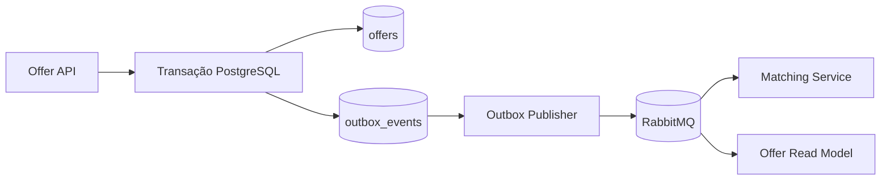
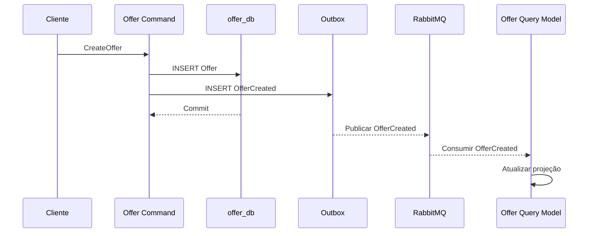

## 03. Database per Service, Consistência Eventual, Dual Write, Outbox e CQRS

---

## 1. Objetivo

Definir a estratégia de persistência da Ravita, os pontos de consistência eventual, o risco de dual write, o padrão Transactional Outbox e a aplicação de CQRS.

---

## 2. Database per Service

Cada microsserviço terá propriedade exclusiva sobre seu banco.

| Serviço | Banco |
|---|---|
| Organization Service | `organization_db` |
| Offer Service | `offer_db` |
| Demand/Matching Service | `matching_db` |
| Redistribution Service | `redistribution_db` |
| Logistics Service | `logistics_db` |

A proposta inicial utiliza **PostgreSQL em instâncias/containers separados**.

### Regra

> Um microsserviço nunca consulta ou altera diretamente o banco de outro serviço.

Quando precisar de dados externos, utilizará:

- API;
- evento;
- projeção local derivada de eventos.

---

## 3. Motivo do isolamento

O isolamento permite:

- autonomia de evolução;
- propriedade clara do dado;
- transações locais;
- menor acoplamento;
- independência de implantação.

O custo é que não existe uma única transação ACID entre todos os serviços.

Por isso, parte do sistema trabalhará com **consistência eventual**.

---

## 4. Pontos de consistência eventual

### Oferta → Matching

```text
Offer Service
    ↓
OfferCreated
    ↓
RabbitMQ
    ↓
Matching Service
```

Durante alguns instantes, o Matching pode ainda não conhecer a nova oferta.

**Defasagem aceitável proposta:** até 5 segundos.

### Offer Write Model → Offer Read Model

```text
Offer Write Model
       ↓
OfferCreated / OfferUpdated
       ↓
Offer Read Model
```

**Defasagem aceitável proposta:** até 5 segundos.

### Logística → Redistribuição

```text
Logistics Service
       ↓
FoodCollected / FoodDelivered
       ↓
Redistribution Service
```

A redistribuição pode permanecer brevemente no estado anterior até consumir o evento.

---

## 5. Dual Write

Dual write ocorre quando um serviço precisa:

1. alterar seu banco;
2. publicar um evento.

Exemplo problemático:

```text
UPDATE offers   ✓
PUBLICAR EVENTO ✕
```

O banco registra a alteração, mas outros serviços nunca recebem o evento.

Também pode ocorrer o inverso:

```text
PUBLICAR EVENTO ✓
COMMIT BANCO    ✕
```

Outros serviços acreditam que a alteração aconteceu, embora a transação local tenha falhado.

---

## 6. Transactional Outbox

Para reduzir esse risco, o Offer Service utilizará Transactional Outbox.

Na mesma transação PostgreSQL:

```sql
BEGIN;

INSERT INTO offers (...);

INSERT INTO outbox_events (
    event_id,
    event_type,
    aggregate_id,
    payload,
    created_at
);

COMMIT;
```

Assim, a oferta e o evento pendente são persistidos atomicamente.

---

## 7. Publicação da Outbox



Após confirmação de publicação, o registro da Outbox é marcado como processado.

---

## 8. Estrutura sugerida

```text
outbox_events
----------------------------------
event_id
aggregate_type
aggregate_id
event_type
payload
created_at
published_at
status
attempt_count
```

Estados:

```text
PENDING
PUBLISHED
FAILED
```

---

## 9. Entrega at-least-once e idempotência

A publicação e o consumo serão tratados como **at-least-once**.

Um consumidor pode receber o mesmo evento mais de uma vez.

Por isso, deverá registrar eventos processados:

```text
processed_events
----------------
event_id
processed_at
```

Antes de aplicar o efeito:

```text
evento já processado?
  sim → ignorar
  não → processar
```

---

## 10. Eventos do Offer Service

```text
OfferCreated
OfferUpdated
OfferReserved
OfferReleased
OfferCancelled
OfferExpired
```

Exemplo conceitual:

```json
{
  "eventId": "evt-123",
  "eventType": "OfferCreated",
  "occurredAt": "2026-10-20T13:00:00-03:00",
  "aggregateId": "offer-123",
  "data": {
    "donorId": "org-123",
    "foodCategory": "VEGETABLES",
    "quantity": 30,
    "unit": "KG",
    "city": "Lavras",
    "availableUntil": "2026-10-20T17:00:00-03:00"
  }
}
```

---

## 11. CQRS no Offer Service

O CQRS será aplicado ao Offer Service porque o domínio combina:

- comandos de alteração de estado;
- muitas consultas por filtros;
- pesquisa frequente de ofertas disponíveis;
- diferença clara entre modelo transacional e modelo de consulta.

---

## 12. Command Model

Comandos principais:

```text
CreateOffer
UpdateOffer
ReserveOffer
ReleaseOffer
CancelOffer
ExpireOffer
```

O Command Model utiliza `offer_db` e mantém a fonte autoritativa do estado.

---

## 13. Query Model

Consultas esperadas:

```text
Ofertas disponíveis por cidade
Ofertas por categoria
Ofertas próximas do vencimento
Ofertas de determinado doador
Ofertas compatíveis com uma região
```

Projeção conceitual:

```text
available_offers_read
--------------------------------
offer_id
donor_id
donor_name
food_category
quantity
unit
city
available_until
status
```

Os dados podem ser desnormalizados, pois o objetivo é leitura eficiente.

---

## 14. Atualização do Read Model



---

## 15. Defasagem aceitável

Para o projeto, o modelo de leitura poderá ficar **até 5 segundos** defasado em relação ao modelo de escrita.

Operações que exigem consistência imediata não confiam somente na projeção.

A reserva, por exemplo, sempre é validada pelo Command Model.

---

## 16. Exemplo de concorrência

Uma instituição consulta:

```text
Offer 123 → AVAILABLE
```

Outra instituição a reserva logo depois.

Mesmo que o Read Model ainda mostre `AVAILABLE`, uma nova tentativa será validada no Command Model.

Resultado esperado:

```http
409 Conflict
```

Assim:

- o Query Model oferece velocidade;
- o Command Model preserva a integridade da regra de negócio.

---

## 17. Resumo

A estratégia de dados utiliza:

- PostgreSQL separado por serviço;
- consistência eventual em pontos definidos;
- Transactional Outbox no Offer Service;
- RabbitMQ;
- consumidores idempotentes;
- CQRS no Offer Service;
- defasagem de até 5 segundos no modelo de leitura.

---

## Checklist antes do commit

- [ ] Cada serviço possui banco próprio.
- [ ] Nenhum serviço acessa banco de outro.
- [ ] Pontos de consistência eventual estão identificados.
- [ ] Dual write está explicado.
- [ ] Outbox possui fluxo completo.
- [ ] CQRS possui Command e Query Model.
- [ ] Defasagem aceitável foi definida.
- [ ] Reserva sempre valida o Command Model.
