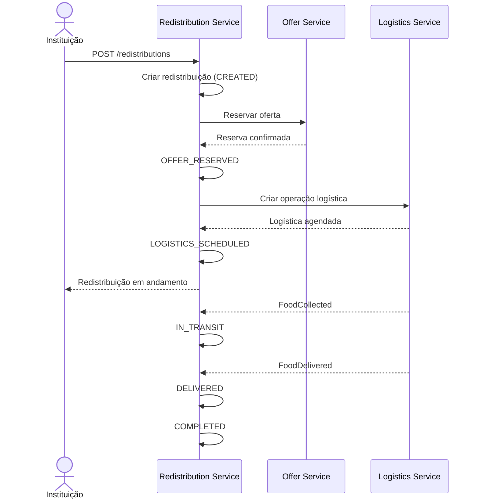
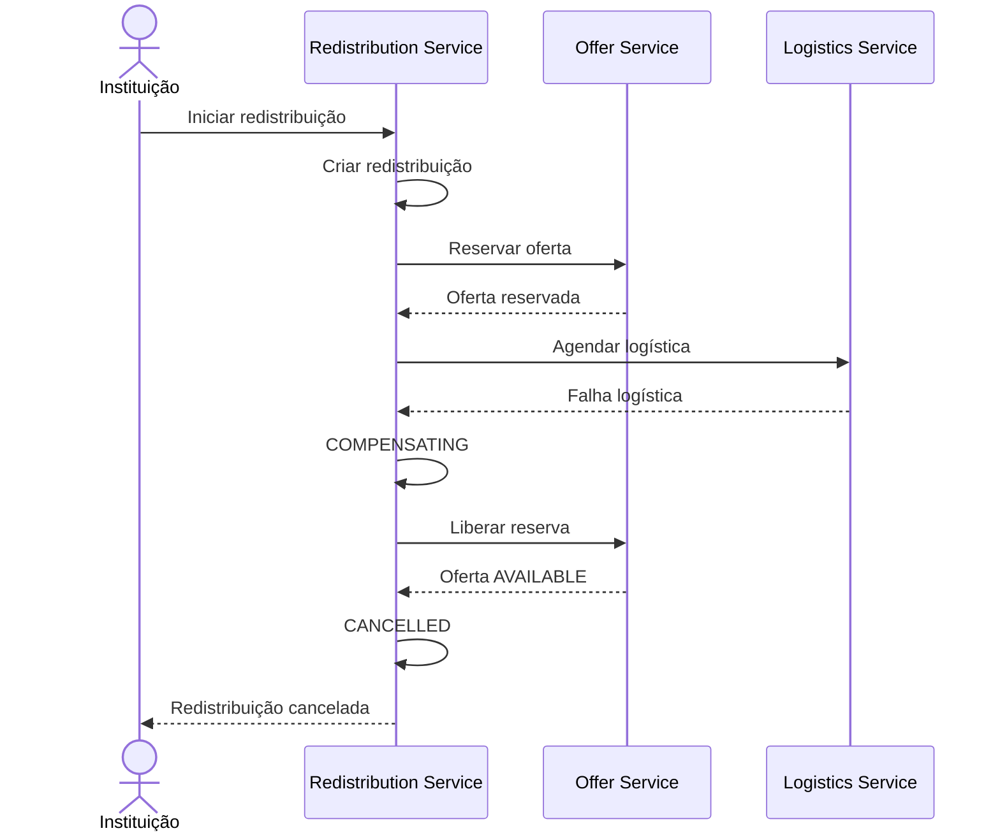

## 04. SAGA de Redistribuição

---

## 1. Objetivo

Modelar a principal transação distribuída da Ravita utilizando SAGA.

A transação escolhida é a criação de uma redistribuição e envolve pelo menos:

- Redistribution Service;
- Offer Service;
- Logistics Service.

O Organization Service participa de validações, mas não precisa compor uma transação compensável da SAGA.

---

## 2. Variante escolhida

A Ravita utilizará **SAGA orquestrada**.

O **Redistribution Service** será o orquestrador.

---

## 3. Justificativa

A SAGA orquestrada foi escolhida porque o fluxo possui uma sequência clara:

1. criar redistribuição;
2. reservar oferta;
3. agendar logística;
4. acompanhar entrega;
5. concluir redistribuição.

Um orquestrador explícito facilita:

- acompanhar o estado global;
- controlar compensações;
- demonstrar o fluxo academicamente;
- diagnosticar falhas;
- evitar lógica de coordenação espalhada por vários serviços.

Na alternativa coreografada, cada serviço reagiria a eventos e decidiria o próximo passo. Para o escopo da Ravita, isso aumentaria a dificuldade de acompanhar e demonstrar a transação completa.

---

## 4. Estados da SAGA

```text
CREATED
RESERVING_OFFER
OFFER_RESERVED
SCHEDULING_LOGISTICS
LOGISTICS_SCHEDULED
IN_TRANSIT
DELIVERED
COMPLETED
COMPENSATING
CANCELLED
FAILED
```

---

## 5. Pré-condições

Antes do primeiro passo compensável:

- a oferta deve existir;
- a instituição deve existir;
- a instituição deve estar ativa;
- a solicitação deve possuir os identificadores necessários.

A validação da organização pode ocorrer antes do início das transações compensáveis.

---

## 6. Transações locais

### T1 — Criar redistribuição

**Serviço:** Redistribution Service

```text
Redistribution.status = CREATED
```

Compensação:

```text
CancelRedistribution
```

### T2 — Reservar oferta

**Serviço:** Offer Service

Sucesso:

```text
Offer → RESERVED
```

Falhas possíveis:

- oferta já reservada;
- oferta cancelada;
- oferta expirada;
- quantidade indisponível.

Compensação:

```text
ReleaseOffer
```

Resultado, se a oferta ainda estiver válida:

```text
Offer → AVAILABLE
```

### T3 — Agendar logística

**Serviço:** Logistics Service

Sucesso:

```text
Logistics → SCHEDULED
```

Compensação:

```text
CancelLogistics
```

---

## 7. Caminho feliz



---

## 8. Passo a passo do caminho feliz

1. Instituição inicia:

```http
POST /api/v1/redistributions
```

2. Redistribution Service cria o registro local.
3. Orquestrador solicita `ReserveOffer`.
4. Offer Service confirma a reserva.
5. Orquestrador solicita `ScheduleLogistics`.
6. Logistics Service confirma.
7. Logística publica `FoodCollected` e `FoodDelivered`.
8. Redistribution Service conclui a redistribuição.

---

## 9. Cenário de falha escolhido

Cenário obrigatório:

> A oferta foi reservada, mas a logística não conseguiu agendar a coleta.

```text
Redistribuição criada   ✓
Oferta reservada        ✓
Logística agendada      ✕
```

Manter a oferta reservada seria incorreto, então a SAGA executa compensações.

---

## 10. Compensação



---

## 11. Tabela de compensações

| Transação | Compensação |
|---|---|
| Criar redistribuição | Cancelar redistribuição |
| Reservar oferta | Liberar oferta |
| Agendar logística | Cancelar logística |

Nem toda falha executa todas as compensações.

Se a logística nunca chegou a ser criada:

```text
Falha logística
      ↓
ReleaseOffer
      ↓
CancelRedistribution
```

---

## 12. Falha durante compensação

As compensações serão idempotentes.

Se uma compensação falhar temporariamente:

```text
COMPENSATING
     ↓
retry com backoff
     ↓
sucesso
```

Após o limite de tentativas:

```text
FAILED
```

A operação deverá ficar visível para intervenção administrativa.

---

## 13. Idempotência

Comandos distribuídos possuirão:

```text
sagaId
commandId
correlationId
```

O serviço receptor deverá registrar mensagens/comandos já processados para evitar efeitos duplicados.

---

## 14. Timeout

O orquestrador não espera indefinidamente.

```text
ReserveOffer
   ↓
timeout
   ↓
retry/consulta
   ↓
sem confirmação
   ↓
COMPENSATING
```

Os valores exatos serão definidos na implementação e nos testes.

---

## 15. Concorrência na reserva

```text
Instituição A ─┐
               ├─> Offer 123
Instituição B ─┘
```

Somente uma reserva pode vencer.

A segunda tentativa recebe:

```http
409 Conflict
```

Essa garantia pertence ao Offer Service.

---

## 16. Cenário para demonstração futura

Na Parte 4, a falha poderá ser provocada assim:

```text
1. Criar oferta
2. Instituição seleciona a oferta
3. Iniciar redistribuição
4. Oferta passa para RESERVED
5. Forçar Logistics Service a rejeitar o agendamento
6. SAGA entra em COMPENSATING
7. Reserva é liberada
8. Oferta volta para AVAILABLE
9. Redistribuição fica CANCELLED
```

---

## 17. Observabilidade

O painel administrativo deverá permitir acompanhar:

- `sagaId`;
- estado atual;
- serviço aguardado;
- última transação concluída;
- última falha;
- número de tentativas;
- `correlationId`.

---

## 18. Resumo

A Ravita utilizará SAGA orquestrada para coordenar a redistribuição.

O Redistribution Service:

- cria e acompanha a SAGA;
- solicita reserva ao Offer Service;
- solicita logística ao Logistics Service;
- recebe eventos de coleta e entrega;
- executa compensações quando necessário.

O cenário principal de falha será a indisponibilidade da logística após a reserva da oferta, resultando na liberação da oferta e no cancelamento da redistribuição.

---

## Checklist antes do commit

- [ ] SAGA atravessa pelo menos três serviços.
- [ ] Variante orquestrada está justificada.
- [ ] Transações locais estão identificadas.
- [ ] Compensações estão definidas.
- [ ] Caminho feliz possui diagrama.
- [ ] Cenário de falha possui diagrama.
- [ ] Idempotência está prevista.
- [ ] Cenário é demonstrável posteriormente.
