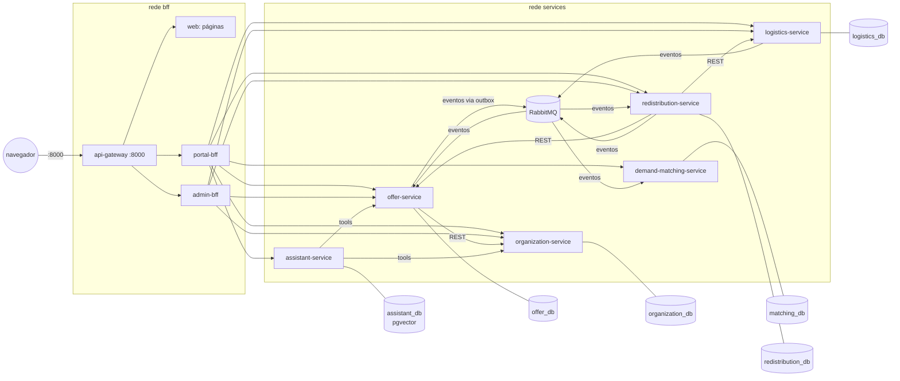

## 05. Containerização com Docker e Docker Compose

---

## 1. Objetivo

Descrever como cada serviço da Ravita é empacotado em imagem Docker e como o sistema completo sobe com um único comando (`docker compose up --build`): 17 containers, entre os 5 serviços de domínio, o assistente de doação, os 2 BFFs, o API Gateway, as páginas dos clientes, 6 bancos e o RabbitMQ. O desenho inclui:

- um Dockerfile próprio por serviço, em multi-stage build;
- o API Gateway como única porta publicada no host;
- um banco PostgreSQL por serviço, com volume para persistência;
- redes que isolam cada banco do restante do sistema;
- healthchecks que ordenam a inicialização.

As instruções de execução estão na seção **Execução** do [README](../../README.md).

---

## 2. Visão geral



Cada banco fica numa rede interna só com o seu serviço (seção 8). O gateway e as páginas ficam só na rede `bff`; os BFFs ficam nas redes `bff` e `services`. Assim, uma requisição de fora só chega a um serviço de domínio passando por um BFF.

---

## 3. Dockerfiles

| Serviço | Estágio de build | Estágio final | Cache de dependências | Jar em camadas | Usuário não-root | `.dockerignore` |
|---|---|---|---|---|---|---|
| organization-service | `maven:3.9.9-eclipse-temurin-21-alpine` | `eclipse-temurin:21-jre-alpine` | sim | não | sim | sim |
| demand-matching-service | `maven:3.9-eclipse-temurin-17` | `eclipse-temurin:17-jre-alpine` | sim | não | sim | sim |
| offer-service | `maven:3.9.9-eclipse-temurin-21-alpine` | `eclipse-temurin:21-jre-alpine` | sim | sim | sim | sim |
| redistribution-service | `maven:3.9.9-eclipse-temurin-21-alpine` | `eclipse-temurin:21-jre-alpine` | sim | não | sim | sim |
| logistics-service | `maven:3.9.9-eclipse-temurin-21-alpine` | `eclipse-temurin:21-jre-alpine` | sim | não | sim | sim |
| api-gateway, portal-bff, admin-bff | `maven:3.9.9-eclipse-temurin-21-alpine` | `eclipse-temurin:21-jre-alpine` | sim | sim | sim | sim |
| assistant-service | `python:3.12-slim` (instala as dependências em `/install`) | `python:3.12-slim` | sim (`requirements.txt` antes do código) | — | sim | sim |
| web | — (arquivos estáticos) | `nginx:alpine` com o `nginx.conf` próprio | — | — | processos de atendimento do nginx sem root | sim |

O assistant-service tem um terceiro estágio, `test`, que roda os testes (`docker build --target test ./assistant-service`); o `docker compose build` não o executa, porque a imagem final não depende dele.

Todos seguem a mesma estrutura:

1. **Estágio de build**: imagem com JDK e Maven. Copia o `pom.xml`, baixa as dependências (`mvn dependency:go-offline`), copia o `src` e gera o jar com `mvn package -DskipTests`.
2. **Estágio final**: imagem só com o JRE. Cria um usuário sem privilégios, copia apenas o jar do estágio anterior e executa `java -jar`.

Nenhum serviço usa imagem pronta de terceiros sem customização: as imagens oficiais (`maven`, `eclipse-temurin`) são apenas a base dos estágios. PostgreSQL e RabbitMQ usam as imagens oficiais, configuradas pelo compose (banco, usuário, volume, healthcheck).

---

## 4. Multi-stage build e o ganho obtido

O estágio de build precisa de JDK, Maven, do repositório local de dependências (`~/.m2`), do código-fonte e da pasta `target`. Nada disso é necessário para executar o serviço, que só precisa do JRE e do jar. Com multi-stage, a imagem final carrega apenas o segundo estágio:

- **Imagem menor**: sem JDK, Maven, `~/.m2` e código-fonte. O pull e a subida dos containers ficam mais rápidos e ocupam menos disco.
- **Menor superfície de ataque**: a imagem em execução não tem compilador, ferramenta de build nem o código-fonte.
- **Build reprodutível**: a compilação acontece sempre na mesma imagem, independente do Java ou Maven instalado na máquina de quem executa.

Tamanhos medidos (preencher após o build):

| Serviço | Estágio de build | Imagem final |
|---|---|---|
| organization-service | | |
| demand-matching-service | | |
| offer-service | | |
| redistribution-service | | |
| logistics-service | | |

Como medir, por exemplo no offer-service:

```bash
docker compose build
docker images "ravita/*"                                          # tamanho das imagens finais
docker build --target build -t ravita/offer-service:build ./offer-service
docker images ravita/offer-service                                # compara o estágio de build com a imagem final
```

O nome do estágio de build é `build` no organization, no demand-matching e no offer, e `builder` no redistribution e no logistics.

---

## 5. Cache de dependências

O `pom.xml` é copiado e as dependências são baixadas **antes** de copiar o `src`. Como o Docker reaproveita uma camada enquanto os arquivos copiados para ela não mudam, uma alteração apenas no código não baixa as dependências de novo: o rebuild recomeça a partir do `COPY src`.

No offer-service, o jar também é separado em camadas (`java -Djarmode=tools -jar application.jar extract --layers`): dependências, loader do Spring Boot, dependências snapshot e código da aplicação. Mudar só o código altera apenas a última camada da imagem final.

---

## 6. Usuário não-root

Todas as imagens finais criam o usuário `ravita` e executam a aplicação com `USER ravita`. Se a aplicação for comprometida, o processo dentro do container não tem privilégios de root.

---

## 7. Configuração por variáveis de ambiente

Nenhum endereço de banco, broker ou serviço fica fixo na imagem: tudo vem do `docker-compose.yml`. O mesmo jar roda localmente (valores padrão do `application.yml`) ou no compose.

| Serviço | Variáveis |
|---|---|
| organization-service | `SERVER_PORT`, `DATABASE_URL`, `DATABASE_USERNAME`, `DATABASE_PASSWORD` |
| demand-matching-service | `SERVER_PORT`, `SPRING_DATASOURCE_*`, `SPRING_RABBITMQ_*` |
| offer-service | `SERVER_PORT`, `DB_*`, `RABBITMQ_*`, `ORGANIZATION_SERVICE_URL` |
| redistribution-service | `SERVER_PORT`, `DB_*`, `RABBITMQ_*`, `OFFER_SERVICE_URL`, `LOGISTICS_SERVICE_URL` |
| logistics-service | `SERVER_PORT`, `DB_*`, `RABBITMQ_*` |
| api-gateway | `SERVER_PORT`, `JWT_SECRET`, `PORTAL_BFF_URL`, `ADMIN_BFF_URL`, `WEB_URL` |
| portal-bff, admin-bff | `SERVER_PORT` e a URL de cada serviço que chamam (`OFFER_SERVICE_URL`, `ASSISTANT_SERVICE_URL`...) |
| assistant-service | `SERVER_PORT`, `GOOGLE_API_KEY`, `GEMINI_CHAT_MODEL`, `GEMINI_EMBEDDING_MODEL`, `DB_*`, `OFFER_SERVICE_URL`, `ORGANIZATION_SERVICE_URL` |

No demand-matching, o `application.yml` tem valores fixos. As variáveis `SPRING_*` têm precedência sobre ele no Spring Boot, por isso o compose consegue redirecioná-lo sem alterar o código.

Credenciais têm valores padrão no compose e podem ser trocadas em um arquivo `.env` (modelo em `.env.example`; o `.env` não é versionado). A `GOOGLE_API_KEY` do assistente e o `JWT_SECRET` do gateway também ficam nele.

---

## 8. Redes e isolamento

| Rede | Tipo | Participantes |
|---|---|---|
| `bff` | bridge | api-gateway, web, portal-bff, admin-bff |
| `services` | bridge | portal-bff, admin-bff, os 5 serviços, assistant-service e RabbitMQ |
| `organization-data` | interna | organization-service, organization_db |
| `offer-data` | interna | offer-service, offer_db |
| `matching-data` | interna | demand-matching-service, matching_db |
| `redistribution-data` | interna | redistribution-service, redistribution_db |
| `logistics-data` | interna | logistics-service, logistics_db |
| `assistant-data` | interna | assistant-service, assistant_db (pgvector) |

Consequências:

- Um serviço só resolve o nome do **próprio** banco. Para o redistribution-service, por exemplo, o nome `offer-db` não existe. Isso reforça o padrão Database per Service na infraestrutura, não apenas por convenção.
- As redes de banco são `internal`: não têm saída para fora do Docker.
- O gateway não participa da rede `services`: para ele, `offer-service` não existe (`wget` responde `bad address`). Toda requisição de fora passa por um BFF.
- **Só o api-gateway publica porta no host (8000)**. Serviços, BFFs, assistente, bancos e o painel do RabbitMQ não são acessíveis de fora.
- Para depurar ou usar a coleção "Serviços diretos" do Postman, o `docker-compose.dev.yml` publica de novo as portas 8080 a 8084, 8091, 8092, 8095 e 15672: `docker compose -f docker-compose.yml -f docker-compose.dev.yml up -d`.
- Os serviços se encontram pelo nome na rede `services` (DNS do Docker): o redistribution chama `http://offer-service:8082`, por exemplo.
- O assistant-service sai para a internet (API do Gemini) pela rede `services`, que não é interna.

---

## 9. Volumes e persistência

| Volume | Montado em |
|---|---|
| `organization-db-data` | `/var/lib/postgresql/data` do organization-db |
| `offer-db-data` | `/var/lib/postgresql/data` do offer-db |
| `matching-db-data` | `/var/lib/postgresql/data` do matching-db |
| `redistribution-db-data` | `/var/lib/postgresql/data` do redistribution-db |
| `logistics-db-data` | `/var/lib/postgresql/data` do logistics-db |
| `assistant-db-data` | `/var/lib/postgresql/data` do assistant-db (base vetorial do assistente) |
| `rabbitmq-data` | `/var/lib/rabbitmq` |

- `docker compose down` remove os containers, mas os volumes e os dados permanecem.
- `docker compose down -v` remove também os volumes.
- O RabbitMQ tem `hostname: rabbitmq` fixo, porque ele guarda os dados pelo nome do nó; sem isso, cada container recriado teria um nome novo e não reconheceria os dados do volume.

---

## 10. Ordem de inicialização e healthchecks

- **Bancos**: `pg_isready`.
- **RabbitMQ**: `rabbitmq-diagnostics -q ping`.
- **Assistente**: `GET /health` com o `urllib` do Python (a imagem slim não tem `wget`).
- **Páginas (web)**: `GET /healthz` do nginx.
- **Os 5 serviços, os BFFs e o gateway**: `/actuator/health` (Spring Boot Actuator), que inclui o estado do banco e, no demand-matching, no logistics e no redistribution, o do RabbitMQ. Os BFFs e o gateway não têm banco: o health mostra só que a aplicação está no ar. O teste é um único bloco (`x-spring-healthcheck`) reaproveitado por todos: o `wget` usa a variável `SERVER_PORT` de cada container.

Cada serviço usa `depends_on` com `condition: service_healthy` para o próprio banco e para o RabbitMQ. Sem o healthcheck, o `depends_on` só garantiria que o container do banco foi criado, não que o PostgreSQL já aceita conexões. Dependências entre serviços (offer → organization, redistribution → offer e logistics) usam `service_started`, porque as chamadas REST acontecem durante o uso, não na inicialização.

Todos os containers usam `restart: unless-stopped`.

---

## 11. Escalabilidade

O offer-service pode ser escalado horizontalmente:

```bash
docker compose -f docker-compose.yml -f docker-compose.scale.yml up -d --scale offer-service=3
```

- O serviço não guarda estado em memória: tudo está no `offer_db`, compartilhado pelas réplicas.
- Reservas concorrentes em réplicas diferentes continuam corretas: a `Offer` tem controle otimista de versão (`@Version`), e só uma reserva grava (ver doc 04, seção 15).
- O job de expiração roda em todas as réplicas, mas o UPDATE é idempotente.
- Duas réplicas não podem publicar a mesma porta no host. No compose principal o offer-service já não publica porta; o `docker-compose.scale.yml` (`ports: !reset []`) garante isso também quando ele é combinado com o `docker-compose.dev.yml`. As réplicas são acessadas pela rede `services`.
- Na rede `services`, o nome `offer-service` passa a resolver para todas as réplicas. Cada requisição gera uma linha de log com método, caminho, status e correlation id, prefixada pelo nome da réplica (`offer-service-1`, `-2`, `-3`) no `docker compose logs`.
- A JVM guarda a resolução de DNS em cache (30 segundos, por padrão), então chamadas seguidas de um mesmo serviço Java podem ir para a mesma réplica. Na demonstração, as requisições saem de processos `wget` separados, que resolvem o nome a cada execução.
- No gateway e nos BFFs, o cache de DNS foi reduzido para 5 s. O DNS do Docker responde com validade de 600 s; com cache longo, um BFF ou serviço recriado (com IP novo) ficaria inacessível por minutos, respondendo 503.

---

## 12. Limitações e próximos passos

- O rate limiting do gateway fica em memória: com mais de uma instância do gateway, cada uma teria o seu limite. Para isso seria preciso um armazenamento compartilhado, como Redis.
- O demand-matching-service usa Java 17; os demais usam Java 21.

---

## Checklist antes da entrega

- [ ] Cada serviço tem Dockerfile próprio.
- [ ] Multi-stage build está justificado, com os tamanhos medidos preenchidos na seção 4.
- [ ] Volumes persistem os dados dos bancos.
- [ ] Redes isolam cada banco do restante do sistema.
- [ ] `docker compose up --build` sobe o sistema completo a partir de um clone limpo.
- [ ] O README permite que um terceiro suba o sistema do zero.
