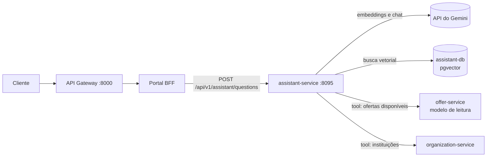

## 07. Integração de LLM: assistente de doação

---

## 1. Objetivo

O assistente responde, no portal, às dúvidas que travam uma doação:

- o doador pergunta se pode doar um alimento, como conservar até a coleta e para quem doar;
- a instituição pergunta o que há disponível agora e como receber e guardar o que chega.

A resposta junta duas coisas que um chatbot genérico não tem:

- **as regras certas**, recuperadas de uma base de conhecimento própria (RAG): a Lei 15.224/2025, a RDC 216/2004 da
  Anvisa, orientações de conservação por categoria e as regras da Ravita;
- **os dados reais do sistema**, obtidos por tools: as ofertas disponíveis, lidas do modelo de leitura do CQRS
  (doc 03), e as instituições que recebem cada categoria, lidas do organization-service.

Exemplo: "Tenho iogurtes que vencem em 3 dias. Posso doar? Quem recebe laticínios?" volta com a regra de validade e
de refrigeração, citando a fonte, e com a lista das instituições cadastradas que aceitam laticínios.

---

## 2. Visão geral



| Peça | Tecnologia |
|---|---|
| Serviço | Python 3.12, FastAPI, LangChain (`langchain-core`, `langchain-google-genai`, `langchain-postgres`) |
| Modelo de chat | `gemini-3.1-flash-lite` (configurável em `GEMINI_CHAT_MODEL`) |
| Embeddings | `gemini-embedding-2` (configurável em `GEMINI_EMBEDDING_MODEL`) |
| Base vetorial | `assistant-db`: PostgreSQL 17 com pgvector, volume próprio e rede interna `assistant-data`, como os outros bancos |
| Resiliência | `tenacity` (retry com backoff), `pybreaker` (circuit breaker), fallback próprio |

A chave da API fica em `GOOGLE_API_KEY`, no `.env`, que não vai para o git. Sem chave, o serviço sobe do mesmo jeito
e responde pelo fallback.

---

## 3. Base de conhecimento

Arquivos Markdown em `assistant-service/knowledge/`. Cada um começa com título e fonte, e cada seção `##` vira o
contexto dos trechos que saem dela.

| Arquivo | Conteúdo | Fonte |
|---|---|---|
| `lei-15224-2025-doacao.md` | O que pode ser doado, responsabilidade do doador (só com dolo), doação fora da relação de consumo, Selo Doador de Alimentos | Lei 15.224/2025, que revogou a Lei 14.016/2020 |
| `rdc-216-2004-boas-praticas.md` | Cozimento, conservação a quente e refrigerada, resfriamento, identificação, transporte, armazenamento, higiene | RDC 216/2004 da Anvisa, itens 4.6 a 4.10 |
| `conservacao-por-categoria.md` | Hortaliças, frutas, laticínios, padaria, grãos e refeições prontas | Orientações da Ravita baseadas na RDC 216/2004 e no rótulo do fabricante |
| `regras-ravita.md` | Categorias, unidades, ciclo da oferta, reserva, coleta, entrega e compensação | Regras dos serviços da Ravita |

A base foi escrita a partir do texto oficial de cada norma. A Lei 14.016/2020, citada no plano original, foi
revogada em outubro de 2025; a base usa a lei em vigor e registra a revogação. A avaliação (seção 8) usa esse caso
para mostrar a diferença entre responder com e sem recuperação.

---

## 4. Pipeline do RAG

| Etapa | Onde | Como |
|---|---|---|
| Ingestão | `app/knowledge.py` | Lê os Markdown e separa por seção |
| Divisão | `app/knowledge.py` | `RecursiveCharacterTextSplitter`, 800 caracteres com 100 de sobreposição; título e seção vão junto com o texto do trecho |
| Embeddings | `app/vectorstore.py` | `GoogleGenerativeAIEmbeddings` com `gemini-embedding-2`; a dimensão é lida do próprio modelo |
| Armazenamento | `app/vectorstore.py` | `PGVectorStore` (langchain-postgres), tabela `ravita_knowledge`, com id estável por trecho |
| Recuperação | `app/assistant.py` | Embedding da pergunta e os 4 trechos mais próximos |
| Geração | `app/assistant.py` | Prompt com os trechos numerados `[1]`..`[4]` e instruções para citar e para dizer "não sei" |

A ingestão roda em segundo plano na subida quando a tabela está vazia; o serviço já responde enquanto isso, com a
busca por palavras-chave. Para refazer: `docker compose run --rm assistant-service python -m app.ingest --force`.

---

## 5. Chain e tools

A composição é uma chain em LCEL, em quatro passos encadeados com `RunnablePassthrough.assign`:

```
recuperar  →  montar o contexto  →  gerar (prompt + modelo com tools)  →  apresentar
```

- **gerar**: o prompt (`ChatPromptTemplate`) vai para o modelo com `bind_tools`. Se o modelo pede uma tool, o
  serviço executa, devolve o resultado como `ToolMessage` e faz a segunda chamada. São no máximo 3 rodadas.
- **apresentar**: extrai o texto, junta as fontes, as tools chamadas e os tokens gastos. Se a geração falhou,
  monta o fallback (seção 7).

| Tool | Chama | Devolve ao modelo |
|---|---|---|
| `buscar_ofertas_disponiveis(categoria, cidade)` | `GET offer-service /api/v1/offers/available` | Até 10 ofertas: descrição, categoria, quantidade, cidade, doador, prazo |
| `instituicoes_que_aceitam(categoria, cidade)` | `GET organization-service /api/v1/organizations?type=INSTITUTION&active=true` | Até 10 instituições que declararam capacidade para a categoria, com o limite |

As tools aceitam a categoria em português ("laticínios") e a convertem para o código do sistema (`DAIRY`). O CNPJ e
os dados de contato das instituições não vão para o modelo. As tools usam as APIs dos serviços, nunca os bancos, e
repassam o `X-Correlation-ID`.

**Por que não um agente.** O fluxo é fixo: recuperar, gerar e, se preciso, consultar uma tool. A única decisão
dinâmica é qual tool chamar, e o tool calling dentro da chain já resolve isso, com limite de rodadas. Um agente com
laço aberto tornaria latência e custo imprevisíveis sem trazer nada que este caso precise.

---

## 6. Contrato

`POST /api/v1/assistant/questions` no assistant-service e `POST /portal/v1/assistant/questions` no Portal BFF.

```json
{ "question": "Tenho iogurtes que vencem em 3 dias. Posso doar? Quem recebe laticínios?", "useRetrieval": true }
```

| Campo | assistant-service | Portal BFF |
|---|---|---|
| `answer`, `mode`, `notice` | sim | sim |
| `sources` (título, seção, fonte de cada `[n]`) | sim | sim |
| `toolCalls` (nome, argumentos, resultados) | sim | como `consultedData` (tool e quantidade de resultados) |
| `retrieval`, `usage`, `model`, `circuitBreaker`, `latencyMs` | sim | só `latencyMs` |

- `mode` é `llm` quando a resposta veio do modelo e `fallback` quando não.
- `useRetrieval: false` existe para a avaliação. O Portal repassa só a pergunta: no portal, a recuperação está
  sempre ligada.
- Erros seguem o contrato dos outros serviços: `400 INVALID_REQUEST` com `{code, message, correlationId}`. Se o
  assistant-service estiver fora do ar, o Portal responde `503 DEPENDENCY_UNAVAILABLE`.

---

## 7. O LLM como dependência remota falível

São três mecanismos; o enunciado pede no mínimo dois.

| Mecanismo | Implementação | Configuração |
|---|---|---|
| Timeout com retry e backoff | `ProviderGuard` (`app/resilience.py`), com `tenacity` | 10 s por chamada; até 3 tentativas; espera exponencial de 0,5 s a 4 s; só para timeout, 429 e 5xx |
| Circuit breaker | `pybreaker` em volta do retry | Abre depois de 3 chamadas seguidas sem sucesso; tenta de novo após 30 s; cada mudança de estado vai para o log |
| Fallback | `app/fallback.py` | Devolve os trechos da base relacionados à pergunta, com o aviso de indisponibilidade e `mode: fallback` |

**Retry só no que é transitório.** Chave inválida, pedido malformado ou modelo inexistente falham igual na segunda
tentativa; repetir só aumenta a latência. Esses erros vão direto para o breaker e para o fallback.

**Orçamento de tempo.** Cada pergunta tem 12 s no total. Uma nova tentativa só começa se sobrar pelo menos 1 s, e o
timeout de cada chamada é o menor entre 10 s e o tempo que resta. Assim, os timeouts ficam encadeados de dentro
para fora:

| Camada | Timeout |
|---|---|
| assistant-service (orçamento da pergunta) | 12 s |
| Portal BFF (leitura da resposta do assistente) | 14 s |
| API Gateway (resposta do BFF) | 15 s |

Cada camada desiste depois da camada de dentro. Por isso, uma falha do provedor chega ao usuário como fallback,
não como 504.

**A recuperação também tem fallback.** O embedding da pergunta é uma chamada ao Gemini e passa pelo mesmo breaker.
Se falhar, ou se a base vetorial estiver fora, a recuperação usa busca por palavras-chave sobre os mesmos trechos,
carregados em memória na subida. O fallback continua útil mesmo com o provedor fora.

| Falha | O que acontece |
|---|---|
| Chave inválida | Sem retry; a resposta sai pelo fallback; depois de 3 chamadas sem sucesso ao provedor (embedding ou chat), o circuito abre |
| Limite por minuto (429) ou 5xx | Até 3 tentativas com backoff; persistindo, fallback |
| Provedor lento | Timeout de 10 s (ou o que restar do orçamento); fallback |
| Circuito aberto | Fallback na hora, sem chamar o provedor, por 30 s |
| assistant-db fora | Recuperação por palavras-chave; o modelo responde normalmente |
| offer-service ou organization-service fora | A tool devolve um erro ao modelo, que responde que não conseguiu consultar |

Para ver o circuito abrir: coloque uma chave inválida no `.env`, faça
`docker compose up -d assistant-service`, envie três perguntas e veja
`docker compose logs assistant-service | Select-String "Circuit breaker"`.

---

## 8. Avaliação do RAG

**Método.** `eval/run_eval.py` faz cada uma das 8 perguntas de `eval/questions.json` com e sem recuperação. As
perguntas cobrem as quatro fontes da base, uma pergunta que exige tool (Q7) e uma fora da base (Q8), que testa se o
modelo admite que não sabe. Para cada resposta, o script mede a cobertura: a fração das informações esperadas
(palavras-chave) que aparecem no texto. A análise abaixo comenta o que a cobertura não capta.

```powershell
docker compose exec assistant-service python -m eval.run_eval
docker compose cp assistant-service:/tmp/avaliacao-llm.md .\avaliacao-llm.md
```

**Resultados** (26/11/2026, `gemini-3.1-flash-lite`, nível gratuito, 16 respostas, todas pelo modelo).

| Pergunta | Com RAG | Sem RAG | Cobertura com / sem |
|---|---|---|---|
| Q1. Quanto tempo a refeição pode ficar aquecida, e a que temperatura? | Correta: acima de 60 °C por até 6 horas, com fonte | Correta | 100% / 100% |
| Q2. Quantos dias dura a refeição refrigerada a 4 °C? | Correta: 5 dias, com fonte | **Errada**: "até 3 dias" | 100% / 0% |
| Q3. O que vai na etiqueta da refeição transportada? | Correta: nome, data de preparo e validade, com fonte | Parcial: inclui nome, data e validade, mas apresenta como mínimo obrigatório itens que a norma não exige | 100% / 50% |
| Q4. A Lei 14.016/2020 ainda vale? | Correta: não; a lei em vigor é a 15.224/2025, com fonte | **Errada**: "continua em vigor" | 50% / 0% |
| Q5. Respondo se o alimento doado fizer mal? | Correta: só com dolo, fora da responsabilidade objetiva do CDC, com fonte | **Errada**: cita a lei revogada e não responde | 100% / 0% |
| Q6. Posso ofertar 2,5 unidades de pão? | Correta: não, UNIT exige número inteiro, com fonte | **Errada**: "Sim, você pode" | 100% / 100% |
| Q7. Posso doar iogurte que vence em 3 dias? Quem recebe laticínios? | Correta: refrigeração, regra dos 2 dias de validade e a instituição real (tool) | Parcial: a instituição real (tool) e a validade, sem a regra dos 2 dias nem o transporte refrigerado | 100% / 100% |
| Q8. Temperatura ideal para mel na colmeia (fora da base) | Correta: diz que não tem a informação e indica a quem perguntar | Responde com conhecimento geral, sem fonte | 0% / 0% |

Cobertura média: **81% com RAG e 44% sem RAG**. Na revisão manual, com RAG foram **8 respostas corretas em 8**;
sem RAG, 1 correta, 2 parciais, 4 erradas e 1 fora do escopo.

**O que os resultados mostram**

- **O RAG corrige conhecimento desatualizado.** Sem recuperação, o modelo afirma que a Lei 14.016/2020 continua em
  vigor (Q4) e a cita como base da responsabilidade do doador (Q5). Com recuperação, ele responde com a Lei
  15.224/2025 e cita a fonte.
- **O RAG traz o detalhe que o modelo erra.** Sem recuperação, o prazo da refeição refrigerada sai como 3 dias (Q2);
  a RDC 216/2004 diz 5.
- **Regras da plataforma só existem na base.** Sem recuperação, o modelo diz que dá para ofertar 2,5 unidades (Q6);
  com recuperação, aplica a regra da Ravita.
- **As tools funcionam nos dois modos.** Em Q7, o modelo chamou `instituicoes_que_aceitam` com e sem recuperação e
  listou a instituição cadastrada; só com recuperação vieram a refrigeração e a regra dos 2 dias de validade.
- **Com recuperação, o modelo admite quando não sabe.** Em Q8, fora da base, ele disse que não tinha a informação,
  como manda o prompt. Sem recuperação, respondeu de memória, sem fonte que permita conferir.
- **Onde o RAG não mudou nada:** em Q1 a regra é conhecida, e o modelo acertou nos dois modos.

**Limites da cobertura automática.** A contagem de palavras-chave não capta o sentido. Ela subestima duas respostas
certas: Q4 com RAG ("não está mais em vigor", sem a palavra "revogada") e Q8 com RAG ("não possuo essa informação",
em vez de "não sei"). E superestima uma errada: Q6 sem RAG contém "inteiras", mas conclui que dá para ofertar. Por
isso a tabela traz também a revisão manual.

---

## 9. Latência e custo

**Latência.** O mesmo script faz 20 chamadas seguidas com recuperação e registra o p50 e o p95, do lado do cliente e
do servidor (`latencyMs`). No nível gratuito, o script espera 8 s entre chamadas para não bater no limite por minuto;
a espera não entra na medida.

**Custo.** Os tokens de entrada e saída de cada resposta vêm do `usage_metadata` e são multiplicados pelo preço do
nível pago. O embedding da pergunta é estimado em 4 caracteres por token.

| Modelo | Entrada (US$ por 1 milhão de tokens) | Saída, com raciocínio (US$ por 1 milhão de tokens) |
|---|---|---|
| `gemini-3.1-flash-lite` (chat) | 0,25 | 1,50 |
| `gemini-embedding-2` (embeddings) | 0,20 | — |

Os dois modelos têm nível gratuito, que é o usado no desenvolvimento e na apresentação. Os preços são os da página
oficial de preços da API do Gemini em novembro de 2026.

**Resultados de latência** (20 chamadas seguidas, com recuperação):

| Medida | p50 | p95 | Média | Máximo |
|---|---|---|---|---|
| Cliente (HTTP) | 1,8 s | 11,6 s | 3,5 s | 11,9 s |
| Servidor (`latencyMs`) | 1,8 s | 11,6 s | 3,5 s | 11,9 s |

- Metade das perguntas foi respondida em até 1,8 s: um embedding e uma chamada ao modelo, ou duas quando há tool.
- A cauda encosta no orçamento de 12 s. São chamadas que precisaram de nova tentativa; uma das 20 esgotou o
  orçamento e saiu pelo fallback, com os trechos da base, em vez de virar erro para o usuário. É o comportamento
  esperado do desenho da seção 7. No nível gratuito, a causa mais provável é o limite por minuto (429), que dispara o
  retry com backoff; para conferir, `docker compose logs assistant-service | Select-String "tentativa"`.
- Cliente e servidor ficam iguais: o custo do HTTP dentro do container é de poucos milissegundos.

**Resultados de custo:**

| Medida | Valor |
|---|---|
| Tokens de entrada por pergunta (média) | 1.642 |
| Tokens de saída por pergunta (média) | 99 |
| Tokens do embedding da pergunta (estimativa) | 21 |
| Custo por pergunta | US$ 0,00056 |
| 10 mil perguntas por mês | US$ 5,63 |
| 100 mil perguntas por mês | US$ 56,32 |

- Cerca de 73% do custo é entrada: o prompt leva as instruções, as definições das tools e os 4 trechos recuperados.
  Recuperar 3 trechos em vez de 4, ou usar trechos menores, é a forma mais direta de reduzir o custo.
- No desenvolvimento e na apresentação, o projeto usa o nível gratuito, sem custo.

---

## 10. Decisões

| Decisão | Motivo |
|---|---|
| Serviço próprio em Python | O ecossistema do LangChain é mais completo em Python; como serviço separado, uma falha do assistente não afeta reserva, coleta nem entrega |
| `gemini-3.1-flash-lite` | Nível gratuito, um dos menores preços da geração atual, suporte a tool calling; desligamento previsto só para maio de 2027. O Google recomenda o `gemini-3.5-flash-lite` para projetos novos; a troca é só mudar `GEMINI_CHAT_MODEL` |
| pgvector em vez de um banco vetorial dedicado | Mesma tecnologia dos outros bancos (PostgreSQL), sem mais um sistema para operar; o volume da base (dezenas de trechos) não exige mais que isso |
| Tools pelas APIs, não pelos bancos | Mantém a regra de um banco por serviço (doc 01); as ofertas vêm do modelo de leitura, feito para consulta |
| Recuperação sempre ligada no portal | `useRetrieval: false` só existe para a avaliação |
| Sem cache de respostas | As tools trazem dados que mudam a cada reserva; um cache por pergunta devolveria ofertas que já foram reservadas |

---

## 11. Limitações

- A base de conhecimento resume as normas; ela não substitui o texto oficial nem a orientação da vigilância
  sanitária local, e o assistente diz isso quando não tem a resposta.
- A Lei 15.224/2025 depende de regulamento para alguns pontos, como o profissional que atesta a qualidade dos
  alimentos; a base registra isso sem detalhar o regulamento.
- No nível gratuito, o limite por minuto do Gemini cai rápido sob carga. Em produção, o nível pago e o
  `BREAKER_FAIL_MAX` ajustado ao volume resolvem.

---

## Fontes

- [Lei nº 15.224, de 30 de setembro de 2025](https://www.planalto.gov.br/ccivil_03/_ato2023-2026/2025/lei/l15224.htm)
- [Lei nº 14.016, de 23 de junho de 2020 (revogada)](https://www.planalto.gov.br/ccivil_03/_ato2019-2022/2020/lei/l14016.htm)
- [RDC nº 216, de 15 de setembro de 2004, da Anvisa](https://www.legisweb.com.br/legislacao/?id=100899)
- [Preços da API do Gemini](https://ai.google.dev/gemini-api/docs/pricing)
- [Modelos e datas de desligamento da API do Gemini](https://ai.google.dev/gemini-api/docs/deprecations)
